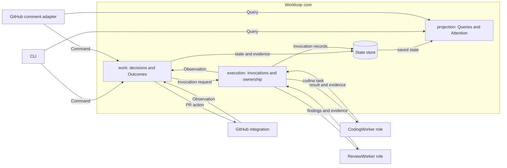

# Architecture and interface boundaries

## Responsibilities

| Component | Owns | Does not own |
| --- | --- | --- |
| Core | Work and Execution IDs, state transitions, capacity, retry/resume policy, evidence, current Attention, execution-ownership decisions | GitHub's issue and PR data, external board state |
| GitHub integration | Issue/PR reads, head revisions, checks, review events and publication | Work ownership or execution authority |
| Executor | Isolated workspace, worker Invocations, process and artifact reporting | Choosing work or declaring a PR reviewed on a newer head |
| Control adapter | Command translation, status projection, external identity mapping | State transitions or independent retry policy |
| CLI | Reference implementation of the control interface | A separate state model |

The initial deployment may place these in one process and one local database. The boundaries are behavioral; v0.1 does not require a distributed service or dynamic plugin loader.

## Module map

This is the intended module boundary, not the current layout of the private implementations. The `work` module owns decisions about a Work item. `execution` supervises the Invocations that carry out those decisions. CodingWorker and ReviewWorker are roles invoked by `execution`, not kinds of Work or Execution. A single Execution may invoke either role more than once. Devin, Claude Code, and the existing `coding-worker` CLI are possible implementations of these roles.

GitHub review events and worker results arrive as Observations. The `work` module decides whether to request a change, accept an Outcome, or wait for more evidence; the workers only perform the requested task and return evidence. `projection` reads saved state for Queries and does not change it. The execution-ownership mechanism is [still under study](glossary.md#execution-ownership-terminology-under-study).

## Command contract

The core exposes commands such as `submit`, `retry`, `resume`, `cancel`, and `acknowledge`, plus read-only queries for status, evidence, and current attention. A command contains:

- a stable Work ID and an idempotency key;
- actor and origin (CLI, GitHub, or another adapter);
- expected state/version, where relevant;
- optional reason and target Execution.

The core returns an accepted/rejected decision, canonical state version, and command ID. `retry` means: create at most one new Execution for eligible, settled Work under the same intent, after checking current evidence and policy. `resume` continues an eligible interrupted Execution from a durable checkpoint; it may start a new Invocation. Adapters cannot implement either by moving a card or spawning a process directly. An unavailable result can be queried by command ID before resubmission. Queries read recorded state; monitors and reconciliation record new Observations before a Projection changes.

## Work and execution

Work has its own identity independent of an issue number or board card. Store GitHub issue references as source links, not primary keys. Each Execution has an execution ID, defined input and budget, zero or more Invocations, process/workspace evidence, checkpoints, and recorded Outcomes. A Work item may have multiple Executions but no more than one active, authoritative Execution. Capacity is reserved atomically with the decision to start work. The mechanism for execution ownership remains to be specified; [Lease is not yet an adopted term](glossary.md#execution-ownership-terminology-under-study).

The state store is the authority for commands and transitions. An append-only event or decision history supports audit and reconstruction; snapshots may accelerate queries. External updates use an outbox and reconciliation so a database commit does not pretend a GitHub or board write succeeded atomically. Webhooks are deduplicated on delivery identity and checked against current Work state.

## Adapters

An adapter implements a narrow protocol:

1. Resolve an external action to a canonical Work ID and command.
2. Submit that command with an idempotency key and state precondition.
3. Render the returned decision and current state.
4. Reconcile its projection after delayed, duplicated, or lost events.

Candidate adapters are a GitHub issue-comment interface, a GitHub Projects projection, and an optional board integration. The CLI is the baseline and must work with every optional adapter disconnected. GitHub Projects offers project item/field APIs, but its fields are presentation and control input, not execution authority.

## Recovery rules

- A heartbeat failure leaves process liveness `unknown` until process evidence is reconciled; it is not immediately `dead`.
- An expired claim does not allow a replacement Execution or Invocation while an old process could still write; recovery must prevent the old owner from writing or establish its termination.
- An external card or comment can lag behind the core. Reconciliation updates the projection; it never changes core state just to match a stale view.
- A new PR head invalidates review conclusions tied to the previous head.
- An adapter outage records a pending projection/notification and leaves execution progressing when policy allows.

## Installation boundary

Each deployment has a separate state database, workspace root, credentials, repository allowlist, and adapter configuration. Logs and exported evidence must redact tokens and avoid copying private source content into other engagements. v0.1 uses one self-hosted instance; shared hosted tenancy is outside scope.
