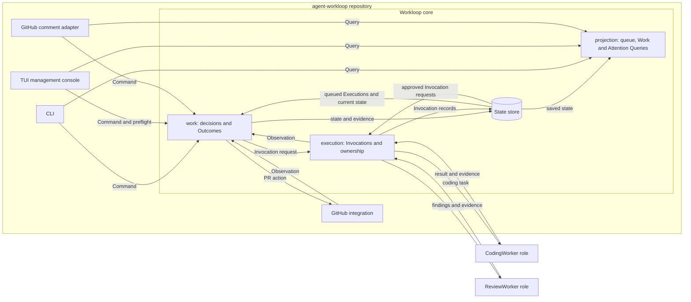

# Architecture and interface boundaries

## Responsibilities

| Component | Owns | Does not own |
| --- | --- | --- |
| Core | Work and Execution IDs, state transitions, built-in work queue, capacity, retry/resume policy, evidence, current Attention, execution-ownership decisions | GitHub's issue and PR data |
| GitHub integration | Issue/PR reads, head revisions, checks, review events and publication | Work ownership or execution authority |
| Executor | Isolated workspace, worker Invocations, process and artifact reporting | Choosing work or declaring a PR reviewed on a newer head |
| Control adapter | Command translation, status projection, external identity mapping | State transitions or independent retry policy |
| CLI | Reference implementation of the control interface | A separate state model |
| TUI management console | Interactive queue, Work, Attention, and evidence views; typed Command submission | Its own queue or Work state, Attention classification, or retry policy |

The initial deployment may place these in one process and one local database. The boundaries are behavioral; v0.1 does not require a distributed service or dynamic plugin loader.

## Module map

This is the intended module boundary, not the current layout of the private implementations. The outer box marks what this repository will implement, including the TUI management console. The inner box marks the Workloop core; being outside that box does not put a module outside this repository. The `work` module owns decisions about a Work item. Its queued Executions and approved Invocation requests form the built-in queue; `projection` presents them as a Kanban-style view without a second card record. `execution` supervises the Invocations that carry out those decisions. CodingWorker and ReviewWorker are roles invoked by `execution`, not kinds of Work or Execution. A single Execution may invoke either role more than once. Devin, Claude Code, and the existing `coding-worker` CLI are possible implementations of these roles.

GitHub review events and worker results arrive as Observations. The `work` module decides whether to request a change, accept an Outcome, or wait for more evidence; the workers only perform the requested task and return evidence. `projection` reads saved state for Queries and does not change it. The TUI reads the queue, Work, Attention, and evidence through Queries, then submits typed Commands for operator decisions. It does not classify state or write the store itself. The execution-ownership mechanism is specified in the [glossary](glossary.md#execution-ownership): reservations, external claims, and stop proof rather than a single Lease entity.

## Command contract

The core exposes commands such as `submit`, `retry`, `resume`, `cancel`, and `acknowledge`, plus read-only queries for status, evidence, and current attention. A command contains:

- a stable Work ID for an existing Work item, or an intent for `submit` so the core can allocate the ID, plus an idempotency key;
- actor and origin (CLI, GitHub, or another adapter);
- expected state/version, where relevant;
- optional reason and target Execution.

The core returns an accepted/rejected decision, canonical state version, and command ID. `retry` means: create at most one new Execution for eligible, settled Work under the same intent, after checking current evidence and policy. `resume` continues an eligible interrupted Execution from a durable checkpoint; it may start a new Invocation. Adapters cannot implement either by moving a card or spawning a process directly. An unavailable result can be queried by command ID before resubmission. Queries read recorded state; monitors and reconciliation record new Observations before a Projection changes.

## Work and execution

Work has its own identity independent of an issue number or board card. Store GitHub issue references as source links, not primary keys. Each accepted Work starts with one queued Execution; an explicit retry creates the next queued Execution under the same Work. Each Execution has an execution ID, defined input and budget, zero or more Invocations, process/workspace evidence, checkpoints, and recorded Outcomes. A Work item may have multiple sequential Executions but no more than one nonterminal, authoritative Execution, including queued and paused ones. Capacity is reserved atomically when a queued Execution is admitted for its first Invocation, not when `submit` or `retry` is accepted. The [lifecycle contract](lifecycle.md) defines the transitions and release points. Execution ownership combines store-enforced resource reservations, TTL-bounded external claims for manual writers, and stop proof over recorded process identities; [the mechanism is specified without adopting the name Lease](glossary.md#execution-ownership).

The state store is the authority for commands, queue eligibility, reservations, and transitions. Queue entries are queued Executions and approved Invocation requests in that store, not separately synchronized cards. Dispatch selects the oldest eligible queued Execution, so a blocked source does not stall independent work. Writer-resource reservations span Work records, external claims, and supported entry points; Work-level single-Execution rules alone do not prevent two Works or a manual command from writing to the same workspace or branch. v0.1 keys each reservation on a workspace ID and a `(repository, branch)` pair, holds it until the Execution's terminal commit, and requires manual writers to register a TTL-bounded claim on the same store. Current-state tables carry the authority and enforce the structural invariants; an append-only `event_log` alongside them supports audit and reconstruction, and snapshots may accelerate queries. External updates use an outbox and reconciliation so a database commit does not pretend a GitHub write or notification succeeded atomically. Webhooks are deduplicated on delivery identity and checked against current Work state.

## Built-in work queue

This repository implements the development queue needed to accept Work, select eligible queued Executions within capacity, and hold uncertain ownership. The management views also show active and completed Work and human Attention. A queue row is a Projection of the same Work, Execution, and Invocation records that Commands change; moving a row in the TUI does not itself change state. A scheduler may propose Candidates, but only an accepted `submit` creates Work and E1. The internal dispatch loop proposes a queued Execution; `work` rechecks eligibility and reserves capacity while saving its first durable Invocation request in one transaction. `execution` consumes only that approved request. A crash or lost response must be reconciled against its request ID and process evidence before another start is permitted. Resume requeues the same Execution; retry creates a new queued Execution. All three commands can be accepted while capacity is full.

The first implementation is a single-instance, single-host development queue. It does not reproduce Hermes Kanban's general-purpose boards, card dependencies, comments, attachments, arbitrary assignees, or generic worker dispatcher. It can use a local database; it does not require a Hermes installation. Existing Hermes cards and their history are outside the new store, and no ongoing card synchronization or migration layer is planned for the initial personal-use deployment.

## Adapters

An adapter implements a narrow protocol:

1. Resolve an external action to a canonical Work ID and command.
2. Submit that command with an idempotency key and state precondition.
3. Render the returned decision and current state.
4. Reconcile its projection after delayed, duplicated, or lost events.

The CLI and TUI management console are control interfaces implemented in this repository. The CLI is the baseline and must work with every optional adapter disconnected. The TUI is part of the intended system: it presents the built-in queue and other Projections, supports an operator's decisions, and submits Commands through the same control boundary as the CLI. It requests a read-only preflight before submission; the core still enforces Command preconditions. After a lost response, it queries the result or replays the same idempotent request. The [hermes-setup console PR](https://github.com/shimpeiws/hermes-setup/pull/386) is the current reference for this interaction pattern; its Rust interaction code may inform this TUI, while its Python projections and action paths remain private implementation details, not additional core authorities.

Candidate external adapters are a GitHub issue-comment interface and a GitHub Projects projection. GitHub Projects fields are presentation and control input, not execution authority. Hermes Kanban is not a required adapter or runtime for new Work.

## Recovery rules

- A heartbeat failure leaves process liveness `unknown` until process evidence is reconciled; it is not immediately `dead`.
- A missed heartbeat or elapsed ownership deadline does not allow a replacement Invocation while an old process could still write; recovery must prevent the old owner from writing or establish its termination.
- An external comment or notification can lag behind the core. Reconciliation records its delivery; it never changes core state just to match a stale external view.
- A new PR head invalidates review conclusions tied to the previous head.
- An adapter outage records a pending projection/notification and leaves execution progressing when policy allows.

## Installation boundary

Each deployment has a separate state database, workspace root, credentials, repository allowlist, and adapter configuration. Logs and exported evidence must redact tokens and avoid copying private source content into other engagements. v0.1 uses one self-hosted instance; shared hosted tenancy is outside scope.
